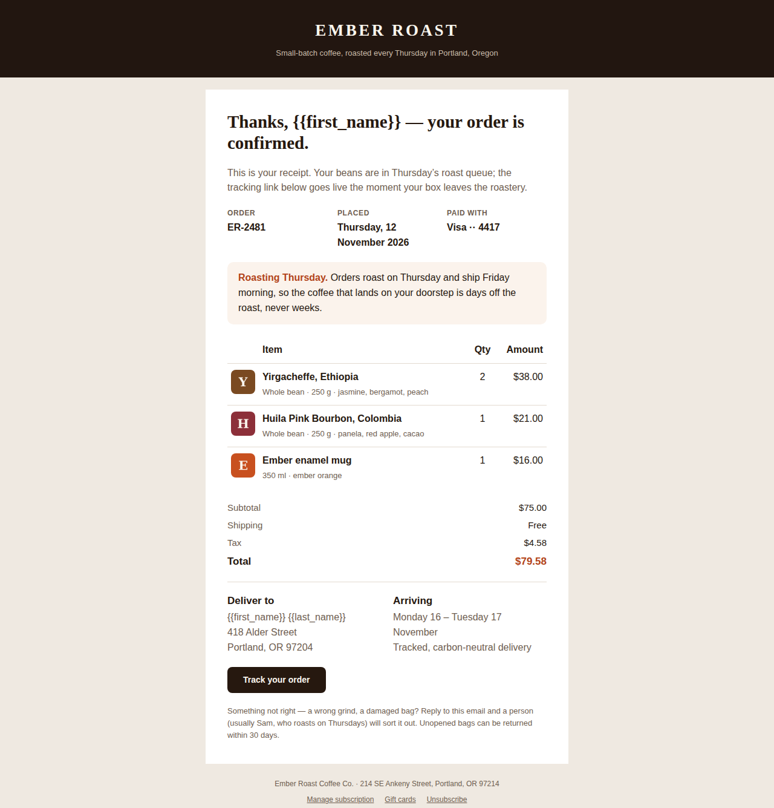
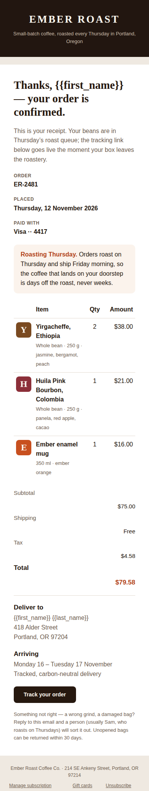

# Ember Roast — order receipt email

A receipt email for **Ember Roast**, a fictional small-batch coffee roaster: masthead, personalised confirmation, order facts, a roast-day note, an itemised table with product chips, computed totals, delivery details and a tracking call to action. Built with [Hyper Elements](https://hyperelements.dev) as a single `<Email>` template — and checked the way the library wants an email checked: with the email-client emulator, before anything is sent.





## Run it

```bash
npm install
npm run render     # validates with the email-clients plugin, renders the email + every client preview
npm run check      # the Hyper Elements CLI check on the template
npm run preview    # screenshots out/email.html with headless Chromium
```

`npm run render` writes:

- `out/email.html` and `out/email.txt` — the email and its plain-text twin (every `render()` returns both, always in sync).
- `out/clients/` — the email as **classic Outlook, Outlook.com, Gmail (web and Mac), Apple Mail and Apple Mail on iPhone** show it, drawn locally by `@hyper-elements/email-clients`. No test sends, no account, nothing uploaded.

**Checks:** `hyper-elements check` reports **0 errors, 0 warnings**. Validation with the email-clients plugin reports only informational notes about graceful degradation in classic Outlook (rounded corners square off; letter-spacing is kept by Word but not drawn) — the email is designed to survive both.

## How Hyper Elements was used

- **The order is data; the numbers are computed.** The `order` object at the top of `src/receipt.tsx` holds the items, quantities and prices. Line amounts, the subtotal, the tax and the total are calculated from it in the template — change the order and the whole receipt, including the totals table, follows. Nothing is hard-coded twice.
- **Merge tags for personalisation.** `<MergeTag name="first_name" />` in the greeting and the delivery block renders as `{{first_name}}` in the HTML and the plain text, ready for any sending provider (or pass the `mergeTag` render option for a provider's own syntax).
- **Real email structure.** A `<Section>` masthead band, a card `<Column>`, a `<Table>` with a header row and hairline `rowBorder`s for the line items, and a `<Button>` that stays a button in clients that drop styling. Layout spacing is `gap` and `padding` — no margins, no hand-written tables, no Outlook conditional comments; the engine writes all of that.
- **A theme and a custom component.** `defineTheme` carries the brand (espresso ink, ember accent, Georgia headings with a Helvetica body — both email-safe stacks) and the type defaults. `ember.MetaField`, defined with `component()` and `prop.text`, renders the order number / date / payment fields and is prop-checked by `validate()` like a built-in.
- **Self-contained product chips.** The item thumbnails are tiny PNGs embedded as data URIs (`src/chips.json`), so the email renders identically everywhere with no image hosting and no blocked-image gaps.
- **The feedback loop.** `src/render.tsx` runs `validate()` with the email-clients plugin, prints `outline()`, renders, then runs `renderInEmailClients()` and saves every client's preview — the create → check → fix loop the library is designed around.

## Make it yours

- **Your order shape:** replace the `order` object — items need a name, a detail line, a quantity, a price in cents and a chip image.
- **Your tax and shipping rules:** `taxRate` and `shippingCents` sit beside the order; the totals rows are built from the computed values.
- **Your brand:** the `ember` theme at the top of `src/receipt.tsx` — colors, fonts, button shape — restyles the whole email.

## Files

- `src/receipt.tsx` — the template (theme, custom component, order data)
- `src/chips.json` — the product chips as data URIs
- `src/render.tsx` — validate (with client checks) → outline → render → client previews
- `scripts/screenshot.mjs` — headless-Chromium screenshots used for the previews above
- `preview.png`, `preview-mobile.png` — the rendered email at desktop and phone widths

MIT licensed.
